<!-- ================== MISSION CONTROL · Omar Mohamed Adel ================== -->

<p align="center">
  
</p>

<p align="center">
  <a href="https://github.com/Om3adel">
    
  </a>
</p>

<p align="center">
  <a href="https://www.linkedin.com/in/omar-mohamed-adel/"></a>
  <a href="https://www.kaggle.com/omar30"></a>
  <a href="https://public.tableau.com/app/profile/omar.adel4320"></a>
  <a href="https://www.upwork.com/freelancers/~012631ea7034870352"></a>
  <a href="https://x.com/OmarMoh10350888"></a>
  <a href="mailto:0mer3adl@gmail.com"></a>
</p>

<p align="center">
  
  
</p>

---

## 🛰️ Mission Briefing

```yaml
callsign:   Omar Mohamed Adel
role:       Data Analyst · Power BI Specialist
base:       Cairo, Egypt 🇪🇬
current:    Data Analyst @ Ministry of Communications and Information Technology (MCIT)
background: Space Technology & Navigation Systems (EGSA)
degree:     B.Sc. Space Navigation · Beni-Suef University (2023)
training:   ITI · Digital Egypt Pioneers Initiative (DEPI) · IMT Data Analytics Diploma
mission:    Turn complex datasets into dashboards and insights that drive decisions
```

<table align="center">
  <tr>
    <td align="center" width="200"><h2>6.5M+</h2><sub>📊 Records analyzed</sub></td>
    <td align="center" width="200"><h2>10+</h2><sub>📈 Dashboards built</sub></td>
    <td align="center" width="200"><h2>3+</h2><sub>🛰️ Space projects</sub></td>
  </tr>
</table>

---

## 🧰 Ship Systems

<p align="center">
  
  
  
  
  
  
  
</p>
<p align="center">
  
  
  
  
  
  
  
</p>

<p align="center"><sub>Data modeling · KPI reporting · Dashboard design · Data storytelling · ETL · RFM segmentation · Time intelligence</sub></p>

---

## 🚀 Featured Missions

<table>
  <tr>
    <td width="50%" valign="top">
      <h3>🥛 Lumina Mart Dairy Intelligence</h3>
      7-page Power BI dashboard analyzing <b>108M EGP</b> in net sales with <b>50% YoY growth</b>, uncovering margin erosion behind strong sales: discounts, promotions, returns and RFM customer segments.<br/><br/>
      
      
      <br/><br/>
      <a href="https://github.com/Om3adel/lumina-mart-dairy-analytics">📂 Repository</a>
    </td>
    <td width="50%" valign="top">
      <h3>🏦 Bank Customer Churn Prediction</h3>
      Power BI dashboard analyzing <b>10,000+ customers</b> to predict churn and drive retention, segmented by age, geography, gender, card ownership and product usage.<br/><br/>
      
      
      <br/><br/>
      <a href="https://github.com/Om3adel/My-Portfolio-Projects/tree/main/Bank%20Customer%20Churn%20Prediction%20Dashboard">📂 Repository</a>
    </td>
  </tr>
  <tr>
    <td width="50%" valign="top">
      <h3>🎓 DEPI Internship Attendance Tracker</h3>
      Power BI on real data from a national internship program: <b>37,950 sessions</b>, <b>575 groups</b> and <b>13,279 students</b>, on a star-schema model with Power Query ETL.<br/><br/>
      
      
      <br/><br/>
      <a href="https://github.com/Om3adel/My-Portfolio-Projects/tree/main/Depi_Attendance%20_Tracker">📂 Repository</a>
    </td>
    <td width="50%" valign="top">
      <h3>📈 Sales Trend & Performance Analytics</h3>
      Retail analysis of <b>$2.26M revenue</b> and <b>$402K profit</b> (2015–2018), built as a Power BI report and an interactive web dashboard: seasonality, quarters and regions.<br/><br/>
      
      
      <br/><br/>
      <a href="https://sales-trend-dashboard-blush.vercel.app/">🌐 Live demo</a> ·
      <a href="https://github.com/Om3adel/My-Portfolio-Projects/tree/main/Sales%20Trend%20%26%20Performance%20Analytics%20Dashboard">📂 Repository</a>
    </td>
  </tr>
  <tr>
    <td width="50%" valign="top">
      <h3>🛰️ Satellite Collision Risk</h3>
      Collision-probability analysis for <b>20+ satellites</b> using orbital data and machine-learning predictions, with interactive Plotly visuals.<br/><br/>
      
      
      <br/><br/>
      <a href="https://github.com/Om3adel/My-Portfolio-Projects/tree/main/Satellite%20Collision_Data_Visualization%20%26%20Prediction/docs">📂 Repository</a>
    </td>
    <td width="50%" valign="top">
      <h3>🌍 Satellite Orbit Propagator & Tracker</h3>
      Python and LabVIEW propagator simulating satellite motion, eclipse periods and ground tracks from TLE data, for mission planning and education.<br/><br/>
      
      
      <br/><br/>
      <a href="https://github.com/Om3adel/My-Portfolio-Projects/tree/main/Satellite%20Orbit%20Propagation%20%26%20Tracking%20System">📂 Repository</a>
    </td>
  </tr>
</table>

<p align="center">
  <a href="https://github.com/Om3adel/My-Portfolio-Projects"></a>
</p>

---

## 🪐 Mission Log

| | Role | Organization |
|:-:|---|---|
| 🟢 | **Data Analyst** *(current)* | Ministry of Communications and Information Technology (MCIT) |
| 🎓 | **Data Analyst & Power BI Specialist Track** | Digital Egypt Pioneers Initiative (DEPI) |
| 🎓 | **Data Scientist Scholarship** · 300-hour program | Digital Egypt Pioneers Initiative (DEPI) |
| 🛰️ | **Satellite Collision Probability Intern** | Egyptian Space Agency (EGSA) |
| 💻 | **Software Engineering Development Fundamentals** | Information Technology Institute (ITI) |
| 🛰️ | **Orbit Determination & Propagation Analysis Intern** | Egyptian Space Agency (EGSA) |

<details>
  <summary><b>🏅 Certifications</b> (click to expand)</summary>
  <br/>

  DEPI Certification · EGSA Space Technology · ITI Professional Certification · AI Powered Data Analysis · Generative AI · Machine Learning for All · IMT Data Analytics Diploma · Orbit Determination & Propagation · International Workshop · Upwork, Khamsat and Mostaqel professional freelancer
</details>

---

## 📡 Telemetry

<p align="center">
  
  
</p>

<p align="center">
  
</p>

<!-- The snake below appears after the "Generate snake" workflow (.github/workflows/snake.yml) has run once. -->
<p align="center">
  <picture>
    <source media="(prefers-color-scheme: dark)" srcset="https://raw.githubusercontent.com/Om3adel/Om3adel/output/github-snake-dark.svg" />
    <source media="(prefers-color-scheme: light)" srcset="https://raw.githubusercontent.com/Om3adel/Om3adel/output/github-snake.svg" />
    
  </picture>
</p>

---

<p align="center"><i>"Turning data into insight and satellites into safe travelers."</i> 🚀</p>

<p align="center">
  <b>📞 Open a channel:</b>
  <a href="mailto:0mer3adl@gmail.com">0mer3adl@gmail.com</a> ·
  <a href="https://www.linkedin.com/in/omar-mohamed-adel/">LinkedIn</a> ·
  <a href="https://www.upwork.com/freelancers/~012631ea7034870352">Hire me on Upwork</a>
</p>

<p align="center">
  
</p>
